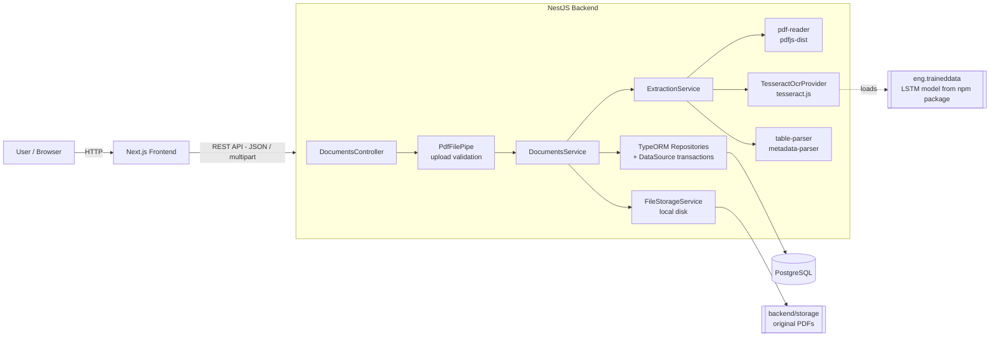
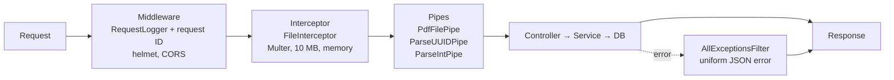
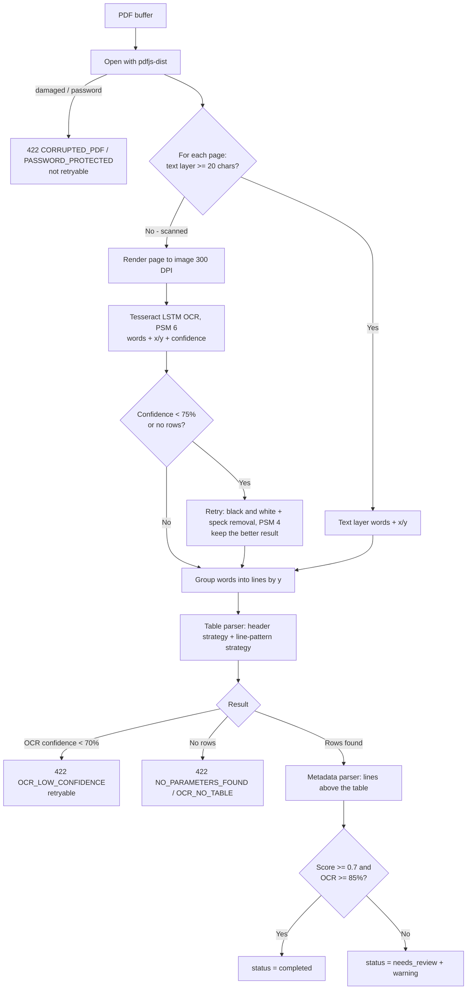
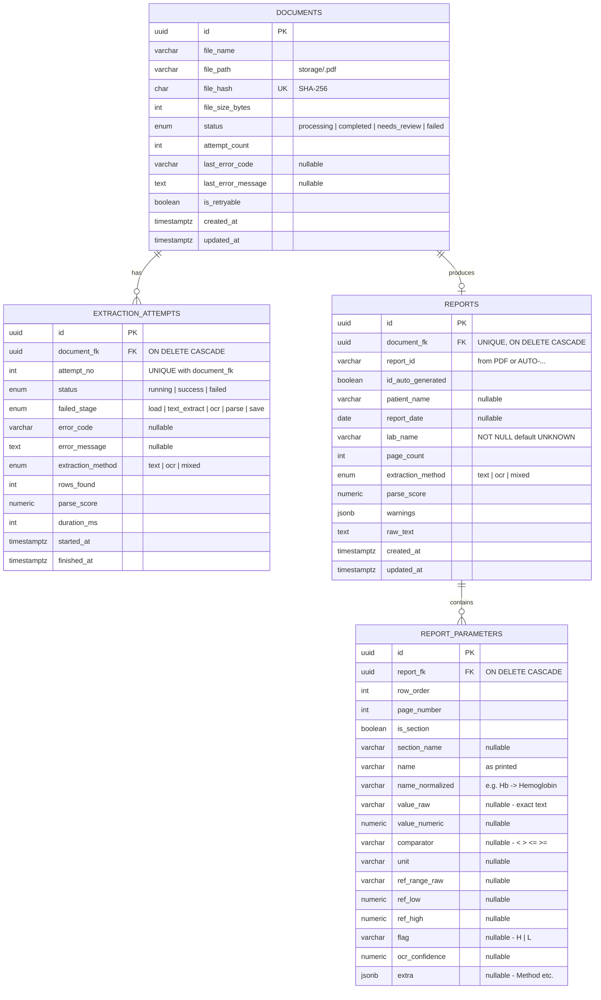

# High-Level Design (HLD) – PDF Report Data Extractor

| Item | Detail |
|---|---|
| Project | PDF Report Data Extraction (Problem Statement 1) |
| Stack | Next.js 16 (frontend) · NestJS 12 (backend) · PostgreSQL (database) |
| PDF reading | `pdfjs-dist` (digital PDFs) · `tesseract.js` LSTM OCR (scanned PDFs) |
| ORM | **TypeORM** (entities + plain-SQL migration) |
| Tests | Vitest (NestJS 12 is ESM-only) |
| Version | 1.1 (matches the implemented system) |

> **Change from the first draft:** the plan used Prisma. During setup npm resolved a Prisma 8 release candidate with a mismatched 7.x client, so the project uses **TypeORM**, the first-party NestJS integration. The schema itself did not change because of this; it is written as a plain-SQL migration so it is easy to review.

---

## 1. Purpose

Labs send reports as PDF files. Each report can contain a **different number of test parameters** (8, 10, 12 or more) and can come from a **different lab layout**.

This system lets a user:

1. Upload a lab report PDF (digital or scanned).
2. Automatically extract the report details and every test parameter (name, value, unit, reference range).
3. Store the data in PostgreSQL against a **Report ID / Sample ID**.
4. View the stored data in a table next to the original PDF.
5. Retry a failed extraction without uploading the file again.

---

## 2. Scope

### In scope
- Single-PDF upload from a web UI.
- Text extraction from digital PDFs and OCR for scanned pages.
- Table detection that works across different layouts and multiple pages.
- Storage of a variable number of parameters per report.
- Listing, viewing, retrying and deleting documents.
- Handling of all edge cases listed in the assignment (section 9).

### Out of scope
- User login / authentication.
- Editing extracted values from the UI.
- Batch upload of many files at once.
- Background job queue (processing is synchronous – see section 12).

---

## 3. Architecture Overview



The system has three tiers:

| Tier | Responsibility |
|---|---|
| **Presentation** – Next.js | Upload screen, documents list, report page (PDF + table), error/warning messages, retry/delete |
| **Application** – NestJS | Validation, duplicate check, file storage, PDF reading, OCR, table parsing, persistence, retry, REST API |
| **Data** – PostgreSQL | Durable storage of documents, attempts, reports and their parameters |

---

## 4. Component Design

### 4.1 Frontend (Next.js)

| Page | Route | Purpose |
|---|---|---|
| Home | `/` | Upload card (drag-and-drop / file picker, progress, clear errors) and the list of uploaded documents with status, retry and delete |
| Report | `/documents/[id]` | **Side-by-side view**: original PDF (left) and extracted table (right) in PDF order, with section headings, H/L highlights, warnings, processing history, raw text, Retry and Delete |

### 4.2 Backend (NestJS) modules

| Module / Class | Responsibility |
|---|---|
| `DocumentsController` | REST endpoints under `/api/documents` |
| `PdfFilePipe` | File present, `.pdf` extension, MIME type, `%PDF-` magic bytes |
| `DocumentsService` | Upload flow (hash → duplicate check → store file → extract → save), retry, list, detail, delete, recovery of interrupted documents on startup |
| `FileStorageService` | Saves the original PDF as `storage/<sha256>.pdf`, streams and deletes it |
| `ExtractionService` | Per-page text vs OCR decision, OCR retry, quality checks, builds the extraction result |
| `pdf-reader` | Opens the PDF, returns every word with its x/y position, renders pages for OCR |
| `TesseractOcrProvider` | Runs Tesseract (one reusable worker) behind the `OcrProvider` interface |
| `table-parser` | Header and line-pattern strategies, row clean-up, scoring |
| `metadata-parser` | Report/Sample ID, patient name, report date, lab name |
| `DatabaseModule` | TypeORM connection, entities, migration run at startup |

### 4.3 Request pipeline (middleware, interceptors, pipes, filters)



| Building block | Implementation | Purpose |
|---|---|---|
| Middleware | `RequestLoggerMiddleware` | Logs method, URL, status, duration and a request ID (`X-Request-Id`) |
| Middleware | `helmet`, CORS | Security headers; only the frontend origin may call the API or embed the PDF |
| Interceptor | `FileInterceptor` (Multer) | Receives the file in memory with a 10 MB limit (413 when larger) |
| Pipe | `PdfFilePipe` | Rejects non-PDF input → 400 |
| Pipe | `ParseUUIDPipe`, `ParseIntPipe` + `DefaultValuePipe` | Validates `:id` and `page` / `limit` → 400 |
| Exception filter | `AllExceptionsFilter` | One error shape `{ statusCode, code, message, ...details, path, timestamp }`; hides internals on 500 |

Unique-constraint violations from PostgreSQL (`23505`) are caught in the service and mapped to **409** (`DUPLICATE_FILE`, `DUPLICATE_REPORT_ID`).

Not used on purpose: an auth guard (no login required), rate limiting (future improvement), Next.js middleware (nothing to protect) and a caching interceptor (not needed at this scale).

---

## 5. Main Flow – Upload a PDF

```mermaid
sequenceDiagram
    actor User
    participant FE as Next.js
    participant API as NestJS API
    participant EX as ExtractionService
    participant DB as PostgreSQL

    User->>FE: Select PDF
    FE->>API: POST /api/documents/upload (multipart)
    API->>API: Validate size / type / %PDF- bytes
    alt invalid file
        API-->>FE: 400 / 413
    end
    API->>API: SHA-256 hash of file
    API->>DB: Find document by file_hash
    alt already uploaded
        API-->>FE: 409 DUPLICATE_FILE + documentId
    end
    API->>API: Save file to storage/<hash>.pdf
    API->>DB: INSERT document (processing) + attempt 1 (running)
    API->>EX: extract(pdfBuffer)
    alt extraction fails (corrupted, no table, poor scan)
        API->>DB: attempt = failed (stage, error); document = failed (retryable?)
        API-->>FE: 422 + documentId + retryable
    end
    API->>DB: BEGIN; insert report + parameters; attempt = success; document = completed / needs_review; COMMIT
    alt same lab + Report ID already exists
        API->>DB: remove the new document and file
        API-->>FE: 409 DUPLICATE_REPORT_ID
    end
    API-->>FE: 201 document + report + parameters
    FE->>User: Report page: PDF + extracted table + warnings
```

**Retry** (`POST /api/documents/:id/retry`) reads the stored file and runs the same flow as a new attempt. The document is claimed with one atomic `UPDATE ... WHERE status <> 'processing'`, so two clicks cannot run twice; a retry replaces the previous report inside the same transaction.

---

## 6. Extraction Engine Design

### 6.1 Pipeline



### 6.2 Digital vs scanned detection
Detection is **per page**, so a PDF with mixed pages works. The report is marked `extraction_method = text | ocr | mixed`.

### 6.3 OCR retry and safe failure
A scanned PDF whose OCR confidence is below **75%** (or that gives no rows) is **retried once** with stronger image clean-up (black and white + 3x3 median filter to remove specks, Tesseract PSM 4). The better attempt is kept.

If the average confidence is still below **70%**, extraction **fails on purpose** (`OCR_LOW_CONFIDENCE`) instead of storing guessed lab values. The document, the stored file and the attempt history remain, so the user can retry (up to 3 attempts in total).

OCR is behind an `OcrProvider` interface (`recognize(image) → lines of words + x/y + confidence`). Only `TesseractOcrProvider` is implemented; a cloud OCR provider can be added later without changing the rest of the system.

### 6.4 Table parsing strategies

| # | Strategy | When it helps |
|---|---|---|
| 1 | **Header synonyms** – find the header line using a dictionary (`Test/Investigation/Parameter`, `Result/Observed Value`, `Unit/Units/UOM`, `Reference Range/Biological Ref. Interval`, plus `Method`, `Flag`); use header x-positions as column boundaries | Most reports; column order does not matter, extra columns are kept |
| 2 | **Line pattern** – `<name> <value> [H/L] [unit] [range]` per line | No header found, or OCR output where positions are unreliable |

**Parse score** = rows with a name and at least a value, unit or range ÷ all data rows. The header strategy wins unless the line pattern scores more than 0.1 higher.

### 6.5 Row clean-up rules

| Situation | Rule |
|---|---|
| Section heading (`HAEMATOLOGY`) | Name-only row in capitals (no digits) → `is_section = true`; following rows get `section_name` |
| Name wrapped to 2 lines | Name-only line directly under a data row is appended to that row's name |
| Value + unit joined (`13.5g/dL`) | Split into value and unit |
| Flag next to value (`128 H`, `245*`, `↑`) | Moved into `flag` |
| No printed flag | H/L calculated from the range (digital PDFs only) |
| Repeated header / "continued" line on the next page | Skipped |
| Footer (`End of Report`, `Pathologist`, `Interpretation`) | Table ends |
| OCR mix-ups in numeric cells (`O`→`0`, `l`→`1`) | Corrected |
| OCR rows without a real value | Dropped (noise) |

### 6.6 Value and range parsing

| Raw value | value_numeric | comparator | flag |
|---|---|---|---|
| `13.5` | 13.5 | – | – |
| `1,85,000` | 185000 | – | – |
| `128 H` | 128 | – | H |
| `<5` | 5 | `<` | – |
| `Positive` / `Nil` / `2-4` | NULL | – | – |

| Raw range | ref_low | ref_high |
|---|---|---|
| `13.0 - 17.0` / `13–17` / `4 to 11` | 13 | 17 |
| `< 200` / `Up to 200` | NULL | 200 |
| `> 40` | 40 | NULL |
| `17 - 13` (reversed) | NULL | NULL + warning |
| `Negative`, `M: 13-17 F: 12-15` | NULL | NULL (kept as text) |

### 6.7 Report details
Regex on the lines above the table for labels: `Report ID`, `Sample ID`, `Lab No`, `Accession No`, `Reg. No`, `Barcode`; patient name; report date (day-first, invalid or future dates ignored); lab name from the top lines.
If no ID is found → `AUTO-<yyyymmdd>-<first 6 chars of file hash>` with `id_auto_generated = true` and a warning.

---

## 7. Database Design

### 7.1 Concept
- A report has a **variable number** of parameters, so parameters are **rows, not columns** (`report_parameters`, one row per test line).
- The uploaded **file** is separate from the extracted **report**, so a failure at any stage still leaves the file and its history, and the whole flow can be retried.

| Table | One row per |
|---|---|
| `documents` | Uploaded PDF (stored path, SHA-256 hash, status, attempts, last error, retryable) |
| `extraction_attempts` | Extraction run (first upload and each retry): status, failed stage, error, method, rows, timing |
| `reports` | Successfully extracted report header (one per document) |
| `report_parameters` | Test line in a report |

### 7.2 Why not the alternatives

| Option | Problem |
|---|---|
| One column per test (`hemoglobin`, `glucose`…) | Breaks whenever a new test appears; mostly NULL columns |
| Single JSONB column with all parameters | Flexible but hard to query, validate, index and order |
| **Parent–child tables (chosen)** | Unlimited parameters, strong types, easy queries (e.g. "all reports where Glucose > 110") |

JSONB is still used for **small, truly unstructured** data: `warnings` and `extra` columns (e.g. `Method`).

### 7.3 ER diagram



### 7.4 Keys and indexes

| Object | Purpose |
|---|---|
| `documents.file_hash` UNIQUE | Detects the same PDF uploaded twice (also under concurrent uploads) |
| `reports (lab_name, report_id)` UNIQUE | One report per Report/Sample ID per lab (two labs may reuse the same ID) |
| `reports.document_fk` UNIQUE | One report per document; a retry replaces it |
| `extraction_attempts (document_fk, attempt_no)` UNIQUE | Attempt numbers never repeat |
| `documents (status, updated_at)` index | Finds documents stuck in `processing` after a restart |
| `report_parameters (report_fk, row_order)` index | Fast fetch in PDF order |
| `report_parameters (name_normalized)` index | Search across reports by test name |
| FKs `ON DELETE CASCADE` | Deleting a document removes its attempts, report and parameters |

### 7.5 Key design decisions
- `value_raw` always keeps the **exact text** from the PDF, and `value_numeric` holds a number **only when one exists**. Nothing is lost (`Positive`, `<5`, `Nil`), and numeric queries still work.
- `lab_name` is **NOT NULL** (default `UNKNOWN`): PostgreSQL treats NULLs as distinct, which would bypass `UNIQUE(lab_name, report_id)`.
- Values and ranges use exact `numeric`, not floating point.
- Duplicates are enforced by **unique constraints**, not "check then insert", so two simultaneous requests cannot both succeed.

---

## 8. API Design

Base path: `/api`

| Method | Endpoint | Description | Success | Errors |
|---|---|---|---|---|
| POST | `/documents/upload` | Upload + extract + save (multipart field `file`) | 201 document + report | 400, 409, 413, 422 |
| GET | `/documents` | List documents with report summary (`?page=&limit=`) | 200 | 400 |
| GET | `/documents/:id` | Document, report, parameters (PDF order), attempt history, raw text | 200 | 400, 404 |
| GET | `/documents/:id/file` | Stream the original PDF (for the side-by-side view) | 200 | 400, 404 |
| POST | `/documents/:id/retry` | Run the whole extraction again on the stored file | 200 | 404, 409, 422 |
| DELETE | `/documents/:id` | Delete document, attempts, report, parameters and file | 204 | 400, 404 |
| GET | `/health` | API + database status | 200 | 503 |

Standard error body:

```json
{
  "statusCode": 409,
  "code": "DUPLICATE_FILE",
  "message": "This PDF was already uploaded as \"01-basic-8-params.pdf\".",
  "documentId": "c1f2…",
  "documentStatus": "completed",
  "retryable": false,
  "path": "/api/documents/upload",
  "timestamp": "2026-11-22T09:36:42.200Z"
}
```

---

## 9. Edge Case Handling

| Edge case | Handling | HTTP |
|---|---|---|
| Scanned (image) PDF | Per-page detection → Tesseract OCR, one retry with clean-up | 201 |
| Very poor scan | Confidence < 70% after retry → fail, file kept, retry allowed (max 3 attempts) | 422 `OCR_LOW_CONFIDENCE` |
| Missing value / unit / range | Nullable columns; UI shows "—" | 201 |
| Non-numeric values (`<5`, `Positive`, `Nil`) | `value_raw` text + `value_numeric` / `comparator` only when possible | 201 |
| Same PDF uploaded twice | SHA-256 `file_hash` UNIQUE → link to the existing document | 409 `DUPLICATE_FILE` |
| Different file, same lab + Report ID | `UNIQUE(lab_name, report_id)`; the new document and file are removed | 409 `DUPLICATE_REPORT_ID` |
| Report ID missing | `AUTO-…` generated, `id_auto_generated = true`, UI warning | 201 |
| Table spans multiple pages | All pages parsed, repeated headers skipped, `page_number` kept | 201 |
| Non-PDF file | Extension + MIME + `%PDF-` magic bytes (also checked in the browser) | 400 `INVALID_FILE_TYPE` |
| Corrupted / password-protected PDF | pdf.js error → failed, not retryable | 422 |
| File too large (> 10 MB) | Browser check + Multer size limit | 413 |
| No table found (digital PDF) | Attempt recorded, document failed | 422 `NO_PARAMETERS_FOUND` |
| Low parse quality / medium OCR confidence | Saved as `needs_review` with warning | 201 |
| Two retries at the same time | Atomic claim → second request rejected | 409 `ALREADY_PROCESSING` |
| Server stopped mid-processing | On startup, documents stuck > 10 min become failed / `INTERRUPTED`, retryable | – |
| Failure while saving | Single transaction → full rollback, attempt failed at stage `save` | 422 `SAVE_FAILED` |

---

## 10. Non-Functional Requirements

| Area | Approach |
|---|---|
| **Performance** | Digital PDF: < 1 s. OCR: ~5 s per page (more with the retry). One Tesseract worker created on first use and reused. |
| **Reliability** | Report + parameters written in one transaction; attempts recorded for every run; interrupted runs recovered on startup. |
| **Security** | File-type checks, size limit, files processed in memory (never executed), TypeORM parameterised queries, stored paths cannot leave the storage folder, CORS limited to the frontend URL, helmet headers, secrets only in `.env`, internal columns (path, hash) never returned. |
| **Privacy** | Sample PDFs contain fictional data only. Original PDFs are stored on the server's local disk (`backend/storage/`, git-ignored) and only served through the API. |
| **Long OCR requests** | The UI shows "Reading … Scanned PDFs can take up to 30 seconds". |
| **Offline / portability** | The OCR model comes from the `@tesseract.js-data/eng` npm package – no download at runtime, nothing to install besides Node.js and PostgreSQL. |
| **Maintainability** | Parser split into small pure functions; synonyms and units in one dictionary file; 63 automated tests (sample PDFs + business rules). |
| **Observability** | Request log with request ID; extraction log with method, rows and duration; full attempt history in the database. |

---

## 11. Folder Structure

```
pdf-report-extractor/
├── backend/                  NestJS API
│   ├── src/
│   │   ├── database/         TypeORM entities, enums, SQL migration, DatabaseModule
│   │   ├── documents/        controller, service, mapper, file storage, PDF validation pipe
│   │   ├── extraction/       pdf/ (pdf.js), ocr/ (Tesseract), parsing/ (lines, table, values, metadata)
│   │   └── common/           exception filter, request logger
│   ├── storage/              uploaded PDFs (git-ignored)
│   └── .env.example
├── frontend/                 Next.js app
│   ├── app/                  / and /documents/[id]
│   ├── components/           UploadCard, DocumentsTable, DocumentView, ParametersTable, StatusBadge
│   └── lib/api.ts            typed API client
├── samples/                  test PDFs + generate-samples.js
├── docs/                     HLD.md, LLD.md, Test_Cases.xlsx
└── README.md
```

---

## 12. Assumptions

1. No real lab reports were provided; realistic sample PDFs (fictional data) are generated by a script, including scanned versions.
2. Processing is **synchronous** – the user waits a few seconds. A job queue is not needed at this scale.
3. Max upload size is **10 MB**; one PDF per upload.
4. One PDF = one report. If two different files share the same Report ID **from the same lab**, the second is rejected (409).
5. Reports are in English; dates are day-first; OCR uses the English model.
6. Original PDFs are kept on local disk so they can be viewed next to the extracted data and retried. In production this would be object storage (e.g. S3).
7. At most 3 extraction attempts per document.
8. No authentication (not required by the assignment).

---

## 13. Future Improvements

- **Stronger OCR**: deskew, auto-rotation (Tesseract OSD), table-line removal, or a cloud OCR provider behind `OcrProvider`.
- **Gap-detection parsing strategy** for reports that have no header row.
- **Background processing** (BullMQ + Redis) with automatic retries and live status updates.
- **Rate limiting** on uploads (`@nestjs/throttler`) and authentication.
- **Layout profiles** per lab (config files) for known formats.
- **Manual correction UI** for `needs_review` reports; report versioning for corrected reports.
- **`test_catalog` master table** (LOINC codes, standard units) for full normalisation and trend charts per patient.
- **Move stored PDFs to object storage** (S3) instead of local disk.
