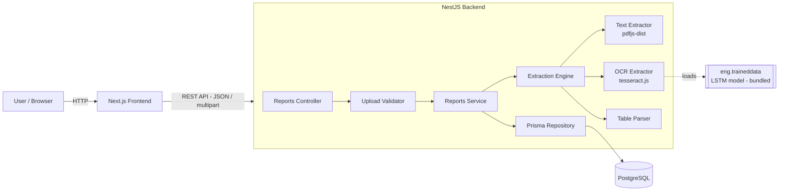
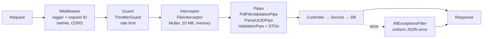
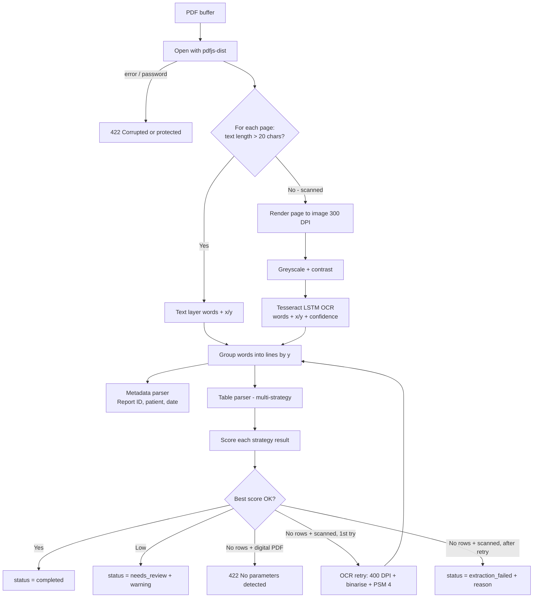
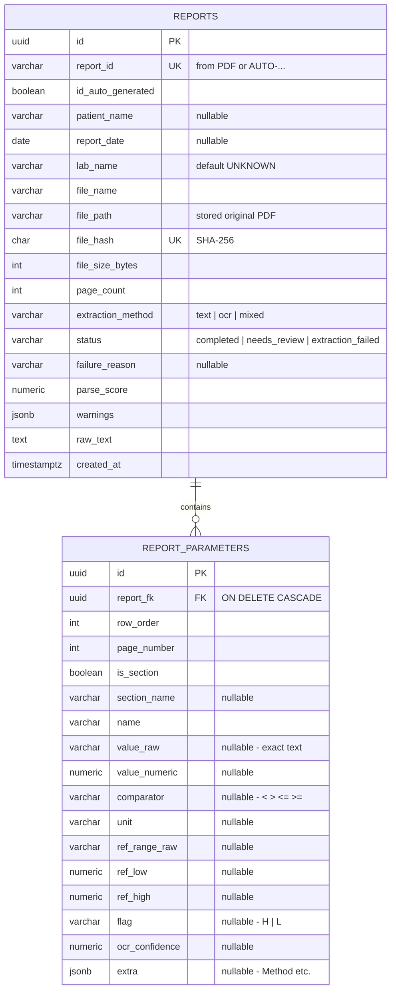

# High-Level Design (HLD) – PDF Report Data Extractor

| Item | Detail |
|---|---|
| Project | PDF Report Data Extraction (Problem Statement 1) |
| Stack | Next.js (frontend) · NestJS (backend) · PostgreSQL (database) |
| PDF reading | `pdfjs-dist` (digital PDFs) · `tesseract.js` LSTM OCR (scanned PDFs) |
| ORM | Prisma |
| Version | 1.0 |


> **Implementation notes (final build vs. this plan)**
> - **TypeORM** replaced Prisma: npm resolved a Prisma 8 release candidate with a mismatched 7.x client. The schema is a plain-SQL migration in `backend/src/database/migrations`.
> - The schema has **4 tables**: `documents` (uploaded file + retry state) and `extraction_attempts` (history of every run) were added in front of `reports` / `report_parameters`, so a failed PDF can be retried without re-uploading. Endpoints are under `/api/documents`.
> - `report_parameters.name_normalized` was added for test-name normalisation.
> - OCR uses the `eng` model from the `@tesseract.js-data/eng` package (no separate `tessdata/` folder, no `sharp`); image clean-up is done on the canvas.
> - Tests use **Vitest** (NestJS 12 is ESM-only). The gap-detection strategy and rate limiting are listed as future improvements.
---

## 1. Purpose

Labs send reports as PDF files. Each report can contain a **different number of test parameters** (8, 10, 12 or more) and can come from a **different lab layout**.

This system lets a user:

1. Upload a lab report PDF (digital or scanned).
2. Automatically extract the report details and every test parameter (name, value, unit, reference range).
3. Store the data in PostgreSQL against a **Report ID / Sample ID**.
4. View the stored data in a table that looks like the original PDF.

---

## 2. Scope

### In scope
- Single-PDF upload from a web UI.
- Text extraction from digital PDFs and OCR for scanned pages.
- Table detection that works across different layouts and multiple pages.
- Storage of a variable number of parameters per report.
- Listing, viewing and deleting reports.
- Handling of all edge cases listed in the assignment (section 9).

### Out of scope
- User login / authentication.
- Editing extracted values from the UI.
- Batch upload of many files at once.
- Background job queue (processing is synchronous – see section 12).

---

## 3. Architecture Overview



The system has three tiers:

| Tier | Responsibility |
|---|---|
| **Presentation** – Next.js | Upload screen, report list, report detail table, error/warning messages |
| **Application** – NestJS | Validation, duplicate check, PDF reading, OCR, table parsing, persistence, REST API |
| **Data** – PostgreSQL | Durable storage of reports and their parameters |

---

## 4. Component Design

### 4.1 Frontend (Next.js)

| Page | Route | Purpose |
|---|---|---|
| Upload | `/` | Drag-and-drop / file picker, progress indicator, clear error messages |
| Reports list | `/reports` | All reports: Report ID, patient, date, parameter count, extraction method, status |
| Report detail | `/reports/[id]` | **Side-by-side view**: original PDF (left) and extracted table (right) in PDF order, with section headings, H/L highlights, warnings, "view raw text" and a "reprocess" button for failed reports |

### 4.2 Backend (NestJS) modules

| Module / Class | Responsibility |
|---|---|
| `ReportsController` | REST endpoints, maps errors to HTTP status codes |
| `UploadValidator` | Size limit, extension, MIME type, `%PDF-` magic bytes |
| `ReportsService` | Orchestrates the flow: hash → duplicate check → extract → parse → save |
| `TextExtractor` | Uses `pdfjs-dist` to get every word with its x/y position per page |
| `OcrExtractor` | Renders a page to an image (~300 DPI), pre-processes it, runs Tesseract, returns words with positions + confidence |
| `TableParser` | Rebuilds rows, finds header/columns, parses values and ranges, merges pages, scores the result |
| `MetadataParser` | Finds Report/Sample ID, patient name, report date, lab name |
| `PrismaService` | Database access, transactions |

### 4.3 Request pipeline (middleware, guards, interceptors, pipes, filters)



| Building block | Implementation | Purpose |
|---|---|---|
| Middleware | `RequestLoggerMiddleware` | Logs method, URL, status, duration and a request ID |
| Middleware | `helmet`, CORS | Security headers; only the frontend origin may call the API |
| Guard | `ThrottlerGuard` | Rate-limits uploads (OCR is CPU-heavy), e.g. 10 per minute per IP |
| Interceptor | `FileInterceptor` (Multer) | Receives the file in memory with a 10 MB limit |
| Pipe | `PdfFileValidationPipe` | File present, `.pdf` extension, MIME type, `%PDF-` magic bytes → 400 |
| Pipe | `ParseUUIDPipe`, global `ValidationPipe` | Validates `:id` and query DTOs (`page`, `limit`) → 400 |
| Exception filter | `AllExceptionsFilter` | One error format; maps Prisma `P2002` → 409, `P2025` → 404, Multer size → 413; hides internals on 500 |

Not used on purpose: an auth guard (no login required), Next.js middleware (nothing to protect) and a caching interceptor (not needed at this scale).

---

## 5. Main Flow – Upload a PDF

```mermaid
sequenceDiagram
    actor User
    participant FE as Next.js
    participant API as NestJS API
    participant EX as Extraction Engine
    participant DB as PostgreSQL

    User->>FE: Select PDF
    FE->>API: POST /api/reports/upload (multipart)
    API->>API: Validate size / type / %PDF- bytes
    alt invalid file
        API-->>FE: 400 Bad Request
    end
    API->>API: SHA-256 hash of file
    API->>DB: Find report by file_hash
    alt already uploaded
        API-->>FE: 409 Conflict + existing report id
    end
    API->>EX: extract(pdfBuffer)
    EX->>EX: For each page: text layer? else OCR
    EX->>EX: Parse metadata + table (multi-strategy)
    alt corrupted / no table found
        API-->>FE: 422 Unprocessable Entity
    end
    API->>DB: BEGIN; insert report + parameters; COMMIT
    API-->>FE: 201 Created + report JSON
    FE->>User: Show extracted table + warnings
```

---

## 6. Extraction Engine Design

### 6.1 Pipeline



### 6.2a OCR retry and graceful failure
A scanned page that gives low OCR confidence (< 60%) or no table rows is **retried once** with stronger image cleanup (400 DPI, greyscale, binarisation, Tesseract PSM 4). The better of the two attempts is kept.

If the retry also fails, the report is **still saved** with `status = extraction_failed` and a reason (e.g. *"Low image quality – OCR confidence 32%"*), together with the raw OCR text. Wrong values are never stored as if they were correct; the duplicate check still works; and the report can be re-processed later without re-uploading.

OCR is behind an `OcrProvider` interface (`recognize(image) → words + x/y + confidence`). Only `TesseractOcrProvider` is implemented; a cloud OCR provider can be added later by configuration without changing the rest of the system.

### 6.2 Digital vs scanned detection
Detection is **per page**, so a PDF with mixed pages works. The report is marked `extraction_method = text | ocr | mixed`.

### 6.3 Table parsing strategies (tried in order, best score wins)

| # | Strategy | When it helps |
|---|---|---|
| 1 | **Header synonyms** – find the header line using a dictionary (`Test/Investigation/Parameter`, `Result/Observed Value`, `Unit/UOM`, `Reference/Normal Range/Biological Ref. Interval`); use header x-positions as column boundaries | Most reports; column order does not matter |
| 2 | **Line regex** – `<name> <value> [H/L] <unit>? <range>?` per line | No header found, or noisy OCR output where positions are unreliable |

**Parse score** = rows that have both a name and a value ÷ all candidate rows. The strategy with the higher score wins.

### 6.4 Row post-processing rules

| Situation | Rule |
|---|---|
| Section heading (`HAEMATOLOGY`) | Row with name only, usually upper-case → stored as `is_section = true` |
| Name wrapped to 2 lines | Name-only line directly under a full row is appended to that row's name |
| Value + unit joined (`13.5g/dL`) | Split by regex |
| Flag next to value (`128 H`, `128*`, `↑`) | Moved into `flag` |
| Repeated header on next page | Skipped |
| Footer (`End of Report`, `Pathologist`, `Interpretation`) | Table ends |
| OCR character mix-ups in value column (`O`→`0`, `l`→`1`) | Corrected |

### 6.5 Value and range parsing

| Raw value | value_numeric | comparator | flag |
|---|---|---|---|
| `13.5` | 13.5 | – | – |
| `128 H` | 128 | – | H |
| `<5` | 5 | `<` | – |
| `Positive` / `Nil` | NULL | – | – |

| Raw range | ref_low | ref_high |
|---|---|---|
| `13.0 - 17.0` / `13–17` | 13 | 17 |
| `< 200` / `Up to 200` | NULL | 200 |
| `> 40` | 40 | NULL |
| `Negative`, `M: 13-17 F: 12-15` | NULL | NULL (kept as text) |

### 6.6 Report ID detection
Regex on the text above the table for labels: `Report ID`, `Sample ID`, `Lab No`, `Accession No`, `Reg. No`, `Barcode`.
If not found → generate `AUTO-<yyyymmdd>-<first 6 chars of file hash>` and set `id_auto_generated = true`.

---

## 7. Database Design

### 7.1 Concept
A report has a **variable number** of parameters, so parameters are **rows, not columns**. A parent–child (one-to-many) design is used:

- `reports` – one row per uploaded PDF.
- `report_parameters` – one row per test line in that PDF.

A report with 8 parameters has 8 child rows; one with 25 has 25 rows. **No schema change is ever needed.**

### 7.2 Why not the alternatives

| Option | Problem |
|---|---|
| One column per test (`hemoglobin`, `glucose`…) | Breaks whenever a new test appears; mostly NULL columns |
| Single JSONB column with all parameters | Flexible but hard to query, validate, index and order |
| **Parent–child tables (chosen)** | Unlimited parameters, strong types, easy queries (e.g. "all reports where Glucose > 110") |

JSONB is still used for **small, truly unstructured** data: `warnings` and `extra` columns (e.g. `Method`).

### 7.3 ER diagram



### 7.4 Keys and indexes

| Object | Purpose |
|---|---|
| `reports.file_hash` UNIQUE | Detects the same PDF uploaded twice |
| `reports (lab_name, report_id)` UNIQUE | One report per Report/Sample ID per lab (two labs may reuse the same ID) |
| `report_parameters (report_fk, row_order)` index | Fast fetch in PDF order |
| `report_parameters (name)` index | Search across reports by test name |
| FK `ON DELETE CASCADE` | Deleting a report removes its parameters |

### 7.5 Key design decision
`value_raw` always keeps the **exact text** from the PDF, and `value_numeric` holds a number **only when one exists**. Nothing is lost (`Positive`, `<5`, `Nil`), and numeric queries still work.

---

## 8. API Design

Base path: `/api`

| Method | Endpoint | Description | Success | Errors |
|---|---|---|---|---|
| POST | `/reports/upload` | Upload + extract + save (multipart field `file`) | 201 report | 400, 409, 413, 422, 500 |
| GET | `/reports` | List reports (paginated: `?page=&limit=`) | 200 | – |
| GET | `/reports/:id` | Report + parameters ordered by `row_order` | 200 | 404 |
| GET | `/reports/:id/raw-text` | Original extracted text | 200 | 404 |
| GET | `/reports/:id/file` | Stream the original PDF (for side-by-side view) | 200 | 404 |
| POST | `/reports/:id/reprocess` | Re-run extraction on the stored PDF (e.g. after `extraction_failed`) | 200 | 404, 422 |
| DELETE | `/reports/:id` | Delete report and its parameters | 204 | 404 |
| GET | `/health` | API + DB health check | 200 | 503 |

Standard error body:

```json
{
  "statusCode": 409,
  "error": "DUPLICATE_REPORT",
  "message": "This PDF has already been uploaded.",
  "existingReportId": "c1f2…"
}
```

---

## 9. Edge Case Handling

| Edge case | Handling | HTTP |
|---|---|---|
| Scanned (image) PDF | Per-page detection → OCR with Tesseract LSTM | 201 |
| Missing value / unit / range | Nullable columns; UI shows "—" | 201 |
| Non-numeric values (`<5`, `Positive`, `Nil`) | `value_raw` text + optional `value_numeric` / `comparator` | 201 |
| Same PDF uploaded twice | SHA-256 `file_hash` UNIQUE → return existing report id | 409 |
| Different file, same Report ID | `report_id` UNIQUE → reject with message (see Assumptions) | 409 |
| Report ID missing | Auto-generate `AUTO-…`, `id_auto_generated = true`, UI warning | 201 |
| Table spans multiple pages | All pages parsed, repeated headers skipped, `page_number` kept | 201 |
| Non-PDF file | Extension + MIME + `%PDF-` magic bytes check | 400 |
| Corrupted / password-protected PDF | Parser error caught | 422 |
| File too large (> 10 MB) | Multer size limit | 413 |
| No table found | Nothing saved | 422 |
| Low-confidence parse | Saved as `needs_review` with warning | 201 |
| Poor-quality scan (OCR cannot read it) | One OCR retry with stronger cleanup; if still unreadable, saved as `extraction_failed` with reason + raw OCR text | 201 |
| Failure in the middle of saving | Single DB transaction → full rollback | 500 |

---

## 10. Non-Functional Requirements

| Area | Approach |
|---|---|
| **Performance** | Digital PDF: < 1 s. OCR: ~2–5 s per page. Tesseract worker created once and reused. |
| **Reliability** | DB transaction per upload; no partial data. |
| **Security** | File-type checks, size limit, files processed in memory (not executed), Prisma parameterised queries, CORS limited to the frontend URL, secrets only in `.env`. |
| **Privacy** | Sample PDFs contain fake data only. Original PDFs are stored on the server's local disk (`backend/storage/`, git-ignored) and are only served through the API. |
| **Long OCR requests** | A multi-page scan with a retry can take 20–30 s. The server timeout is raised for the upload route, and the UI shows a clear "Reading scanned PDF…" message. |
| **Offline / portability** | OCR language model bundled in the repo – no internet download at runtime. |
| **Maintainability** | Parser split into small pure functions with unit tests; header synonyms kept in one config file. |
| **Observability** | NestJS Logger: upload, extraction method, page count, parse score, duration, errors. |

---

## 11. Folder Structure

```
pdf-report-extractor/
├── backend/                  NestJS API
│   ├── prisma/               schema.prisma + migrations
│   ├── src/
│   │   ├── reports/          controller, service, DTOs
│   │   ├── extraction/       text-extractor, ocr-extractor, table-parser, metadata-parser
│   │   ├── common/           filters, validators, utils
│   │   └── prisma/           PrismaService
│   ├── tessdata/             eng.traineddata (bundled OCR model)
│   └── test/                 parser unit tests + e2e tests
├── frontend/                 Next.js app
│   └── app/                  /, /reports, /reports/[id]
├── samples/                  test PDFs + generate-samples.js
├── docs/                     HLD.md
├── docker-compose.yml        PostgreSQL (optional)
├── .env.example
└── README.md
```

---

## 12. Assumptions

1. No real lab reports were provided; realistic sample PDFs (fake data) are generated by a script, including scanned versions.
2. Processing is **synchronous** – the user waits a few seconds. A job queue is not needed at this scale.
3. Max upload size is **10 MB**; one PDF per upload.
4. One PDF = one report. If two different files share the same Report ID **from the same lab**, the second is rejected (409).
5. Reports are in English; OCR uses the English model.
6. Original PDFs are kept on local disk so they can be viewed next to the extracted data and reprocessed. In production this would be object storage (e.g. S3).
7. No authentication (not required by the assignment).

---

## 13. Future Improvements

- **Stronger OCR retry chain**: deskew, auto-rotation (Tesseract OSD), table-line removal.
- **Gap-detection parsing strategy** for reports that have no header row (find columns from vertical white-space and classify them by content).
- **Background processing** (BullMQ + Redis) for large or many PDFs, with live status updates.
- **Layout profiles** per lab (config files) for known formats.
- **AI / cloud fallback** (e.g. AWS Textract, Azure Document Intelligence or an LLM) for layouts the rule-based parser cannot read.
- **Manual correction UI** for `needs_review` reports.
- **Move stored PDFs to object storage** (S3) instead of local disk.
- **Report versioning** when a corrected report arrives with the same Report ID.
- **Trend charts** of a parameter across reports for the same patient.
